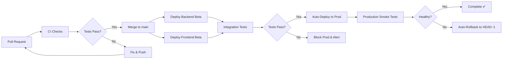

# Deployment Strategy & CI/CD Plan

## Overview

This document outlines the deployment architecture, CI/CD pipeline, testing strategy, and operational procedures for the AI Portfolio Platform.

## Repository Structure: Monorepo

**Decision**: Single monorepo for frontend, backend, infrastructure, and tests.

**Rationale**:
- Shared TypeScript types (no version drift)
- Atomic full-stack commits
- Single source of truth for API contracts
- Simplified dependency management
- Coordinated CI/CD pipelines

```
ai-portfolio-platform/
├── backend/              # Lambda functions, API
├── frontend/             # React dashboard
├── shared/               # Shared types, utilities
├── tests/integration/    # E2E tests
├── .github/workflows/    # CI/CD pipelines
└── docs/                 # Documentation
```

## Deployment Stages

### 1. Beta (Staging)
- **Trigger**: Auto-deploy on merge to `main`
- **Purpose**: Integration testing, QA validation
- **Resources**: Isolated AWS account or separate CloudFormation stacks
- **Data**: Synthetic test data
- **Access**: Internal team only

### 2. Production
- **Trigger**: Auto-deploy after beta integration tests pass
- **Purpose**: Live customer traffic
- **Resources**: Production AWS account
- **Data**: Real customer data
- **Access**: Public
- **Safety**: Automatic rollback on smoke test failure

## CI/CD Pipeline Architecture



## GitHub Actions Workflows

### 1. Backend CI/CD (`backend-ci.yml`)

**Triggers**: 
- Push to `main` (paths: `backend/**`, `shared/**`)
- Pull requests

**Jobs**:
1. **Test** (runs on every PR)
   - Lint (ESLint)
   - Type check (TypeScript)
   - Unit tests (Jest)
   - Coverage report

2. **Deploy Beta** (on merge to `main`)
   - Build Lambda packages
   - CDK deploy to beta stack
   - Export outputs (API URLs, ARNs)

### 2. Frontend CI/CD (`frontend-ci.yml`)

**Triggers**: Same as backend

**Jobs**:
1. **Test**
   - Lint
   - Type check
   - Unit tests (Vitest)
   - Build verification

2. **Deploy Beta**
   - Build React app (Vite)
   - Upload to S3
   - Invalidate CloudFront cache

### 3. Integration Tests (`integration.yml`)

**Triggers**: After backend/frontend deploys complete

**Jobs**:
1. **Integration Test Beta**
   - End-to-end tests (Playwright)
   - API contract tests
   - HTML generation validation
   - Chat functionality tests
   - Blocks production on failure

### 4. Production Promotion (`production-promotion.yml`)

**Triggers**: After integration tests complete successfully

**Jobs**:
1. **Check Integration Tests**
   - Verify beta tests passed
   - Gate production deployment

2. **Deploy Backend Prod**
   - Build and deploy to production
   - Slack notification on success

3. **Deploy Frontend Prod**
   - Build and deploy to production
   - CloudFront invalidation
   - Slack notification on success

4. **Smoke Test Prod**
   - Critical path verification
   - Health check endpoints
   - Triggers rollback on failure

5. **Auto-Rollback** (on smoke test failure)
   - Checkout previous commit (HEAD~1)
   - Redeploy backend and frontend
   - Slack alert with rollback confirmation

## Testing Strategy

### Unit Tests
- **Location**: `backend/src/**/*.test.ts`, `frontend/src/**/*.test.tsx`
- **Framework**: Jest (backend), Vitest (frontend)
- **Coverage**: 80% minimum
- **Runs**: Every PR, local pre-commit

### Integration Tests
- **Location**: `tests/integration/`
- **Framework**: Playwright + Jest
- **Scope**: 
  - File upload → content extraction → manifest update
  - Chat message → intent detection → HTML regeneration
  - Publish workflow → CloudFront invalidation
  - Authentication flow (Cognito)

### Smoke Tests
- **Purpose**: Fast production health check
- **Tests**:
  - API Gateway reachable
  - Lambda cold start < 5s
  - S3 bucket accessible
  - CloudFront serving HTML

## CDK Infrastructure

### Multi-Stack Strategy

```typescript
// backend/cdk/bin/app.ts
const app = new cdk.App();
const stage = app.node.tryGetContext('stage') || 'dev';

new PortfolioBackendStack(app, `PortfolioBackend-${stage}`, {
  stage,
  env: {
    account: process.env.CDK_DEFAULT_ACCOUNT,
    region: 'us-east-1',
  },
});

new PortfolioFrontendStack(app, `PortfolioFrontend-${stage}`, {
  stage,
  env: {
    account: process.env.CDK_DEFAULT_ACCOUNT,
    region: 'us-east-1',
  },
});
```

### Stack Outputs
- API Gateway endpoint URL
- S3 bucket names
- CloudFront distribution IDs
- Cognito User Pool IDs

Outputs are saved to JSON files and used by subsequent jobs.

## AWS Authentication (OIDC)

**No long-lived credentials in GitHub Secrets.**

Use GitHub OIDC provider to assume AWS IAM roles:

```yaml
- name: Configure AWS Credentials
  uses: aws-actions/configure-aws-credentials@v4
  with:
    role-to-assume: arn:aws:iam::123456789:role/GitHubActionsRole-Beta
    aws-region: us-east-1
```

### IAM Role Trust Policy
```json
{
  "Version": "2012-10-17",
  "Statement": [
    {
      "Effect": "Allow",
      "Principal": {
        "Federated": "arn:aws:iam::123456789:oidc-provider/token.actions.githubusercontent.com"
      },
      "Action": "sts:AssumeRoleWithWebIdentity",
      "Condition": {
        "StringEquals": {
          "token.actions.githubusercontent.com:aud": "sts.amazonaws.com",
          "token.actions.githubusercontent.com:sub": "repo:yourorg/ai-portfolio-platform:ref:refs/heads/main"
        }
      }
    }
  ]
}
```

## Deployment Checklist

### Initial Setup (One-Time)
- [ ] Create AWS accounts (beta, prod)
- [ ] Set up OIDC provider in AWS IAM
- [ ] Create IAM roles for GitHub Actions
- [ ] Configure GitHub Environments (beta, production)
- [ ] Add required secrets to GitHub
- [ ] Bootstrap CDK in both accounts (`cdk bootstrap`)
- [ ] Set up Slack webhook for alerts

### Per-Deploy (Automated)
- [x] CI checks pass (lint, type-check, tests)
- [x] Code review approved
- [x] Backend deployed to beta
- [x] Frontend deployed to beta
- [x] Integration tests pass (blocks prod if fail)
- [x] **Auto-promotion to production** (no manual approval)
- [x] Smoke tests pass
- [x] Monitoring dashboards updated
- [x] Auto-rollback on smoke test failure

## Rollback Strategy

### Automatic Rollback Triggers
1. **Integration tests fail in beta** → Block prod deploy, alert team
2. **Smoke tests fail in prod** → Auto-rollback to HEAD~1
3. **CloudWatch alarms (5xx rate > 5%)** → Alert for manual investigation

### Automatic Rollback Process
When smoke tests fail after production deployment:
1. Workflow automatically checks out previous commit (HEAD~1)
2. Rebuilds and redeploys backend (CDK)
3. Rebuilds and redeploys frontend (S3 + CloudFront)
4. Sends Slack alert with rollback confirmation
5. Team investigates failed commit offline

**Recovery Time**: ~5-10 minutes (automated)

### Manual Rollback
For situations requiring manual intervention:
```bash
# Rollback backend (CDK)
cd backend/cdk
npx cdk deploy --context stage=prod --rollback

# Rollback frontend (S3 versioning)
aws s3 sync s3://prod-frontend-backup/v1.2.3 s3://prod-frontend-bucket
aws cloudfront create-invalidation --distribution-id XYZ --paths "/*"
```

### Rollback Testing
- Quarterly chaos engineering exercises
- Blue-green deployment simulation
- Recovery Time Objective (RTO): < 15 minutes

## Debugging Deployed Applications

### Backend (Lambda)
```bash
# Tail logs from beta
aws logs tail /aws/lambda/PortfolioBackend-beta-ContentProcessor --follow

# Invoke Lambda locally with SAM
sam local invoke ContentProcessor --event events/s3-upload.json

# Remote debugging
aws lambda update-function-configuration \
  --function-name PortfolioBackend-beta-ContentProcessor \
  --environment "Variables={NODE_OPTIONS=--inspect-brk=0.0.0.0:9229}"
```

### Frontend
```bash
# Check CloudFront logs
aws logs tail /aws/cloudfront/PortfolioFrontend-beta --follow

# Debug build locally
cd frontend
VITE_API_ENDPOINT=https://beta-api.example.com npm run dev

# Test production build locally
npm run build
npm run preview
```

### Integration Tests
```bash
# Run tests against beta
cd tests/integration
TEST_API_ENDPOINT=https://beta-api.example.com npm test

# Run single test
npm test -- --testNamePattern="should upload file and extract content"

# Debug mode
npm test -- --inspect-brk
```

## Monitoring & Observability

### CloudWatch Dashboards
- Lambda invocations, errors, duration
- API Gateway 4xx/5xx rates, latency
- S3 bucket size, request count
- Bedrock token usage, costs

### Alarms
- Lambda error rate > 1%
- API Gateway 5xx > 5%
- Bedrock throttling
- S3 bucket approaching quota

### X-Ray Tracing
Enable for Lambda functions to trace:
- S3 upload → Textract → Bedrock → manifest update
- Chat request → intent detection → HTML generation

## Cost Management

### Budget Alerts
- Beta: $50/month
- Prod: $500/month (initial)

### Cost Optimization
- Lambda reserved concurrency
- S3 Intelligent-Tiering
- CloudFront cost class 100 (US, Europe, Asia)
- Bedrock request batching

## Security

### Secrets Management
- **GitHub Secrets**: AWS IAM role ARNs, API endpoints
- **AWS Secrets Manager**: Database credentials (future), API keys
- **Cognito**: User authentication
- **IAM**: Least-privilege roles for Lambda

### Vulnerability Scanning
- Dependabot for npm dependencies
- Snyk for Docker images (if used)
- AWS Inspector for Lambda layers

## Future Enhancements

### Phase 2: Canary Deployments
- Deploy to 10% of prod traffic
- Monitor metrics for 15 minutes
- Auto-promote or rollback

### Phase 3: Feature Flags
- LaunchDarkly or AWS AppConfig
- Gradual feature rollouts
- A/B testing HTML templates

### Phase 4: Multi-Region
- Primary: us-east-1
- Failover: eu-west-1
- Route53 health checks + failover routing

## Appendix: Required GitHub Secrets

| Secret Name | Description | Example |
|-------------|-------------|---------|
| `AWS_ROLE_ARN_BETA` | IAM role for beta deploys | `arn:aws:iam::123:role/GitHubActions-Beta` |
| `AWS_ROLE_ARN_PROD` | IAM role for prod deploys | `arn:aws:iam::456:role/GitHubActions-Prod` |
| `BETA_API_ENDPOINT` | Beta API Gateway URL | `https://api-beta.example.com` |
| `PROD_API_ENDPOINT` | Prod API Gateway URL | `https://api.example.com` |
| `BETA_FRONTEND_BUCKET` | S3 bucket for beta frontend | `portfolio-frontend-beta` |
| `PROD_FRONTEND_BUCKET` | S3 bucket for prod frontend | `portfolio-frontend-prod` |
| `BETA_CLOUDFRONT_DIST_ID` | Beta CloudFront distribution | `E1234567890ABC` |
| `PROD_CLOUDFRONT_DIST_ID` | Prod CloudFront distribution | `E0987654321XYZ` |
| `SLACK_WEBHOOK_URL` | Slack alerts webhook | `https://hooks.slack.com/...` |
| `TEST_USER_EMAIL` | Integration test user | `test@example.com` |
| `TEST_USER_PASSWORD` | Integration test password | Managed by team |

---

**Last Updated**: 2026-10-12  
**Owner**: Platform Team  
**Review Cycle**: Monthly
